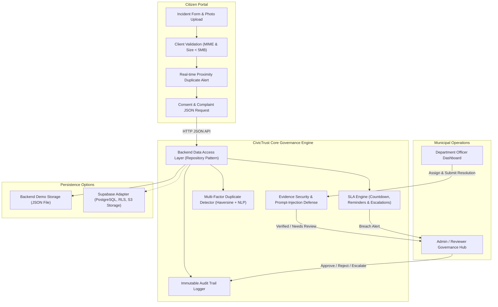
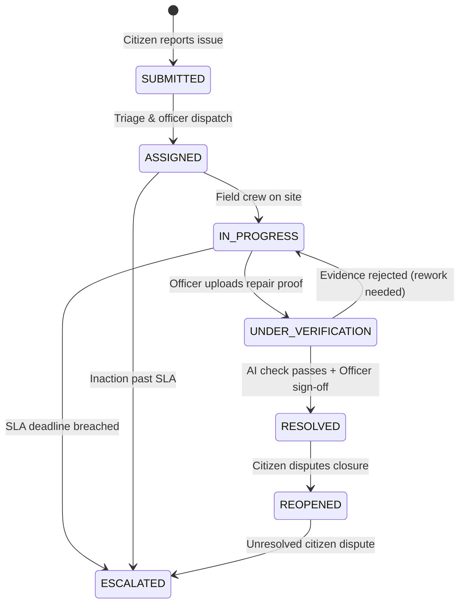

# CivicTrust AI — Architecture & Product Design

CivicTrust AI is an accountable, transparent smart city complaint management system built for **HackO'Ween (Agentic AI × SDG Hackathon — SDG 11: Sustainable Cities & Communities)**.

## High-Level System Architecture

The application is split into `frontend/` and `backend/`, with shared domain helpers in `shared/`. The frontend runs on port 3000 and the JSON API runs on port 3001. The backend persists complaint and audit state to `backend/data/civictrust.json`; browser `localStorage` is not used for application data.

---

## 1. Complaint Lifecycle State Machine

---

## 2. Multi-Factor Duplicate Detection Formula

To prevent municipal backlog and duplicate ticket clutter without silencing citizens, CivicTrust AI evaluates potential duplicates using an explainable multi-factor formula:

$$\text{Similarity Score} = w_{\text{cat}} \cdot S_{\text{cat}} + w_{\text{geo}} \cdot S_{\text{geo}} + w_{\text{time}} \cdot S_{\text{time}} + w_{\text{text}} \cdot S_{\text{text}}$$

Where:
- **Category Match ($w_{\text{cat}} = 0.35$):** $1.0$ if category is identical, $0.0$ otherwise.
- **Geographic Proximity ($w_{\text{geo}} = 0.35$):**
  - Distance $< 80\text{m} \implies 1.0$
  - Distance $< 250\text{m} \implies 0.70$
  - Distance $< 500\text{m} \implies 0.40$
  - Distance $\ge 500\text{m} \implies 0.0$
- **Temporal Proximity ($w_{\text{time}} = 0.20$):**
  - $\le 12\text{h} \implies 1.0$
  - $\le 48\text{h} \implies 0.75$
  - $\le 7\text{ days} \implies 0.25$
- **Text Phrasing Overlap ($w_{\text{text}} = 0.10$):** Jaccard token overlap between incident descriptions.

**Governance Rule:** When $\text{Score} \ge 60\%$, the complaint is flagged for administrator triaging. **The system NEVER silently deletes or auto-merges citizen complaints.**

---

## 3. SLA Tiering & Escalation Matrix

| Priority | Default Categories | Guaranteed SLA | Escalation Tier |
| :--- | :--- | :--- | :--- |
| **Critical** | Water Main Burst, Exposed Wire | **12 Hours** | Level 2: Chief Engineer / Commissioner |
| **High** | Major Pothole on Arterial Road, Clogged Sewage | **24 Hours** | Level 2: Superintending Engineer |
| **Medium** | Overflowing Garbage Bin, Debris | **48 Hours** | Level 1: Assistant Sanitation Commissioner |
| **Low** | Streetlight Flicker, Broken Signage | **72 Hours** | Level 1: Executive Electrical Engineer |

When an SLA is breached:
1. Visual badge shifts to blinking red `OVERDUE by Xh`.
2. Automatic escalation event is recorded in the immutable audit trail.
3. Case is transferred to Level-2 supervisory review with priority status.

---

## 4. Privacy & Untrusted Data Protection

- **Phone Number Fuzzing:** Citizen phone numbers are masked on public views (`+91 98*** **345`).
- **GPS Obfuscation:** Public city map displays neighborhood-level centroids to prevent exposing individual citizen residences.
- **Untrusted File Pipeline:** File extensions, size limits (max 5MB), and MIME types are enforced. File names are rewritten with safe random UUIDs to prevent directory traversal or remote shell exploits.
- **Human Accountability:** AI models provide verification assistance, but high-impact public works closures always require authorized human approval.
